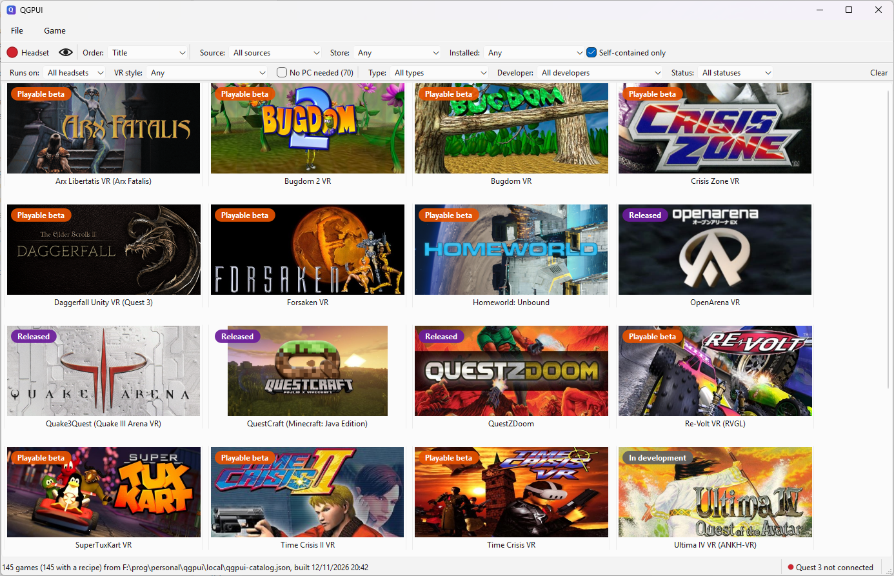
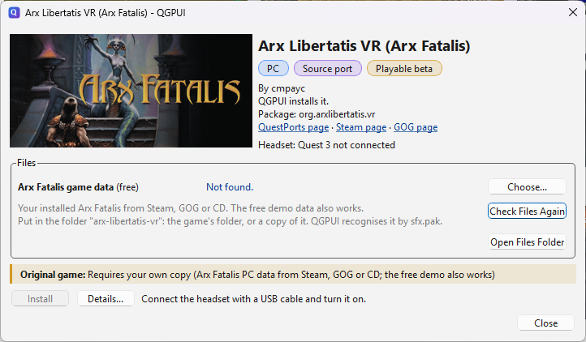

# QGPUI

QGPUI installs [QuestPorts](https://questports.com) games on a Meta Quest headset from a Windows PC or a Mac.

QuestPorts lists ports of PC and console games to the Quest. Many of them need more than an APK:
files from a game you own on Steam or GOG, a ROM or a disc image, copied into the right folder on
the headset. QGPUI finds those files on your PC, downloads the port, and runs every install step
for you.

QGPUI is at an early stage. Expect missing games and rough edges.

## What it does

- **Browse the games.** The main window shows every QuestPorts game as a cover. Sort them, and
  filter by source platform, store, headset model, VR style, type, developer and port status.
  "Self-contained only" shows the games that need nothing you have to supply.
- **Find your files.** QGPUI looks for the PC games a port needs in your Steam, GOG and Epic libraries.
  It looks for everything else in your files folder, one folder per game. You can also pick a file
  or folder by hand.
- **Install and update.** Open a game and press Install. QGPUI downloads the APK from the port's
  releases, installs it, copies your files and tells you when to do a step in the headset. A game
  with a newer release gets an Update tag.
- **Uninstall.** The game dialog removes a game from the headset, with its saves and the files
  copied into its folders, after you confirm.
- **Know what is on the headset.** Games on the connected headset get an Installed tag, whether
  QGPUI installed them or not.
- **Connect without a cable.** Pair or connect a headset over Wi-Fi, or switch a USB headset to
  Wi-Fi.
- **Keep the headset awake.** The eye button on the toolbar keeps the headset's screen on while you
  work, even when you take it off. File > Settings (QGPUI > Settings on a Mac) can also do this during each install.

QGPUI works without a headset connected. You can browse the catalog and check your files at any
time.

## What you need

- A Windows PC, or a Mac with macOS 12 or later. On a Mac, QGPUI finds GOG games only through
  GOG Galaxy. Many ports need files from the Windows version of a game, which Steam and GOG do not
  install on a Mac; copy those files into your files folder.
- A Meta Quest headset with developer mode turned on. Meta's
  [developer mode guide](https://developers.meta.com/horizon/documentation/native/android/mobile-device-setup/)
  explains how.
- The QGPUI catalog file (`qgpui-catalog.json`), which lists the games and how to install them.
  The installer includes one.
- The PC games, ROMs or other files that the ports you want need.

QGPUI comes with its own copy of adb, so you do not need the Android SDK. If no adb is running
when QGPUI starts, QGPUI starts its own and stops it again when you quit.

## Getting QGPUI

Download QGPUI from the [releases page](https://github.com/RangelReale/qgpui/releases). Both
downloads include a catalog, built when the release was made.

- **Windows:** run `qgpui-<version>-setup.exe`. It installs for your user and needs no
  administrator rights.
- **Mac:** open `qgpui-<version>-macos.dmg` and drag QGPUI to Applications. It runs on Apple
  silicon and Intel Macs.

To build QGPUI and its catalog from source, follow [DEVELOPMENT.md](DEVELOPMENT.md).

## Using QGPUI

1. **Open the catalog.** Start QGPUI. It opens the catalog you used last, or the one in its data
   folder (see below), or the one that came with the installer. Use File > Open Catalog to pick
   another one.
2. **Connect your headset.** Connect it with a USB cable and allow USB debugging in the headset.
   Click Headset on the toolbar, or the round indicator in the status bar, to see the headsets
   QGPUI found, pick one, or add one over Wi-Fi. The indicator turns green when a headset is
   connected.
3. **Set up your files folder.** By default it is `Documents\qgpui\files`. Change it in
   File > Settings (QGPUI > Settings on a Mac). Each game's folder holds a `qgpui - what goes here.txt` that says what to
   put there.
4. **Install a game.** Double-click a game. The game dialog shows what the port needs and where
   QGPUI found it, with a Choose button for each. Details shows the port's installation guide and
   every command QGPUI will run. Press Install and follow the progress and the log.

   

## Where QGPUI keeps its data

- Settings: the Windows registry, under `HKEY_CURRENT_USER\Software\qgpui`. On a Mac:
  `~/Library/Preferences/com.qgpui.qgpui.plist`.
- The catalog and a copy of each headset's install records: `%APPDATA%\qgpui`. On a Mac:
  `~/Library/Application Support/qgpui/qgpui`.
- On each headset, the list of games QGPUI installed: `/sdcard/qgpui/installs.json`.

## Author

Rangel Reale ([realerangel@gmail.com](mailto:realerangel@gmail.com))
